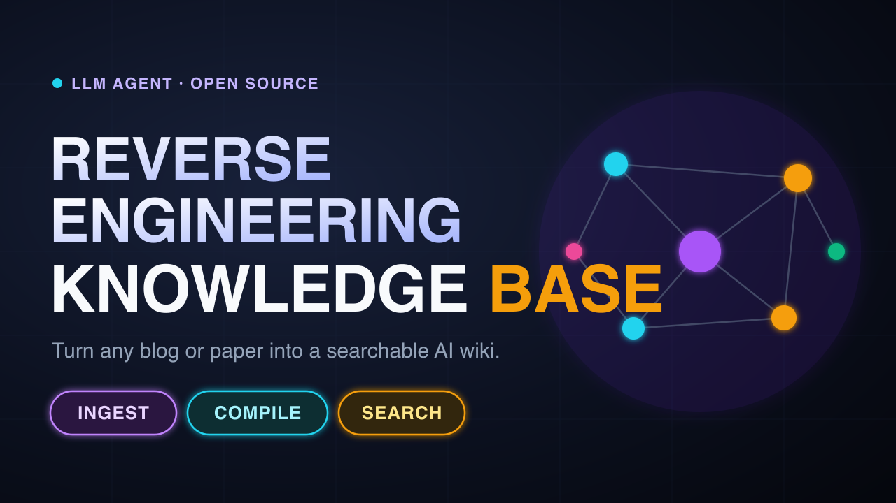

# LLM-RE-WIKI (v1 — YouTube Video Edition)

**The exact code from the YouTube tutorial: an AI knowledge base agent that turns reverse engineering writeups into a searchable Markdown wiki, using your AI coding agent (Claude Code, Cursor, Antigravity).**

[](https://youtu.be/8JgcliENtPQ)
[](https://www.python.org/)
[](https://github.com/fatalSec/LLM-RE-WIKI/tree/v1-video)

<p align="center">
  <a href="https://youtu.be/8JgcliENtPQ">
    
  </a>
</p>

> 📌 **This branch is frozen** so it always matches the video. For the latest version (one-line installer, automatic indexing, health checks), use the [**`main`**](https://github.com/fatalSec/LLM-RE-WIKI) branch.

---

## What It Does

- **Ingest** — Crawl a reverse engineering blog or report into Markdown, with images saved locally.
- **Compile** — Your AI agent turns it into a structured wiki article, keeping offsets, opcodes, hex, and scripts **exactly as written**.
- **Search** — Ask questions and get detailed answers, with each claim marked as *verified from your notes* (`[V]`) or *AI reasoning* (`[AI Synthesis]`).
- **Visualize** — Explore your knowledge base as an interactive graph.

---

## Follow Along With the Video

**1. Clone this branch**

```bash
git clone -b v1-video https://github.com/fatalSec/LLM-RE-WIKI.git
cd LLM-RE-WIKI
```

**2. Set up Python**

```bash
python3 -m venv .kb/scripts/.venv
.kb/scripts/.venv/bin/pip install -r .kb/scripts/requirements.txt
```

**3. Ingest a writeup**

```bash
.kb/scripts/.venv/bin/python .kb/scripts/crawl.py "https://example.com/some-re-writeup"
```

Saves the article to `knowledge_base/raw/feeds/<slug>.md` and its images to `knowledge_base/raw/assets/<slug>/`.

**4. Compile it with your AI agent**

Open the folder in your agent (Claude Code, Cursor, or Antigravity) and type:

```text
compile <slug>.md
```

The agent reads `AGENTS.md`, picks the right template, and writes the article into `knowledge_base/wiki/`.

**5. Ask questions**

```text
search "How does r2-pay detect TracerPid?"
```

**6. Open the knowledge graph**

```bash
.kb/scripts/.venv/bin/python .kb/scripts/graph_generator.py --open
```

---

## Commands

| Command | What it does |
|---|---|
| `ingest <url>` | Download a web page into the inbox with its images |
| `compile <file>` | Turn a raw file into a structured wiki article |
| `search <question>` | Answer from the wiki with provenance markers |
| `graph` | Open the interactive knowledge graph |
| `health-check` | Find broken links and unlinked articles |
| `gap report` | List thin topics and missing coverage |
| `contradictions` | List articles with conflicting claims (`[X]`) |

---

## Provenance Markers

| Marker | Meaning |
|---|---|
| `[V]` | **Verified** — stated in the cited source |
| `[I]` | **Inferred** — a logical conclusion from verified facts |
| `[U]` | **Unverified** — from a forum or unconfirmed source |
| `[VS: Frida 16.x]` | **Version-specific** — only true for that version |
| `[X: see <article>]` | **Contradicted** — another source disagrees |
| `[AI Synthesis]` | **AI reasoning** — from the model's general knowledge, not your notes |

---

## Project Layout

```text
LLM-RE-WIKI/
├── AGENTS.md              # Main instructions the agent reads every session
├── .kb/
│   ├── core-rules.md      # Rules that apply to every task
│   ├── read-protocol.md   # How to search and answer
│   ├── write-pipeline.md  # How to compile raw files
│   ├── ingest-protocol.md # How to crawl URLs
│   ├── index-formats.md   # Index file formats
│   ├── maintenance.md     # Health check and reports
│   ├── schemas/           # Article templates per content type
│   └── scripts/
│       ├── crawl.py           # Web page → Markdown + images
│       ├── graph_generator.py # Knowledge graph data
│       └── requirements.txt
└── knowledge_base/
    ├── raw/               # Inbox: crawled pages and images
    ├── wiki/              # Your compiled knowledge base
    └── graph/             # Graph viewer (index.html)
```

---

## What Changed Since the Video?

| | v1 (this branch) | [`main`](https://github.com/fatalSec/LLM-RE-WIKI) |
|---|---|---|
| Setup | Manual venv | One-line installer + update/uninstall scripts |
| Indexes | Written by the AI | Built automatically by a script |
| Health check | AI reads files | Script checks links and metadata |
| Agents | Claude Code, Cursor, Antigravity | Adds native OpenCode and Pi support |

---

## License

[Apache 2.0](https://github.com/fatalSec/LLM-RE-WIKI/blob/main/LICENSE)
