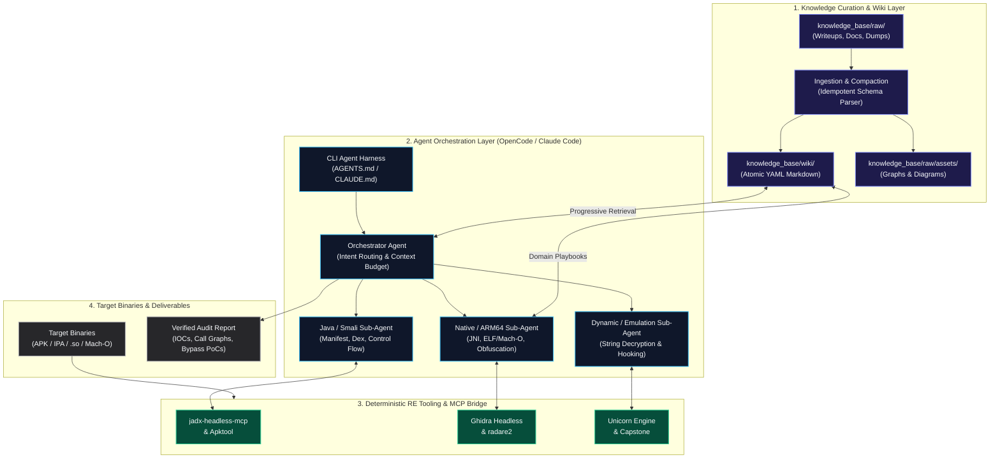
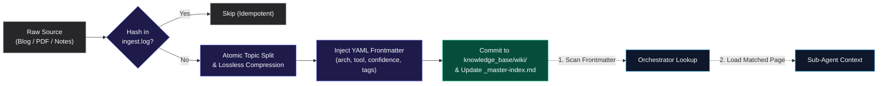
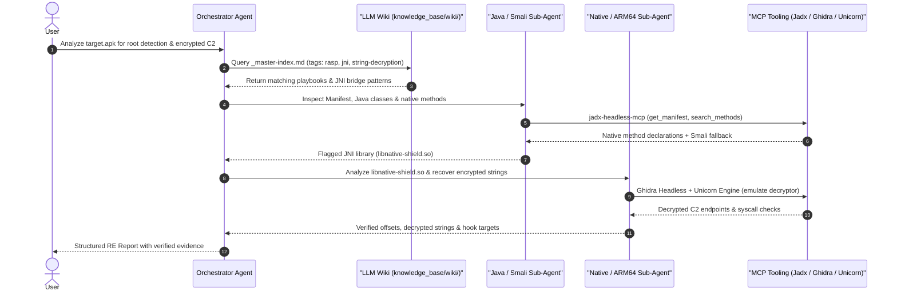

# LLM-RE-Wiki

**A structured, token-optimized Reverse Engineering Knowledge Base and Multi-Agent Orchestration Framework for AI-assisted binary analysis.**

[](#system-architecture)
[](#architectural-layers)
[](#knowledge-engine-ingestion--progressive-retrieval)
[](#license)

---

## Overview

General-purpose LLMs struggle with real-world reverse engineering for three reasons: **context window exhaustion** from raw disassembly/decompilation dumps, **hallucinated APIs or instruction semantics**, and **stateless sessions** that lose hard-won reversing insights across targets.

**LLM-RE-Wiki** solves this by decoupling **persistent domain knowledge** from **deterministic binary analysis**:
- **Persistent LLM Wiki (`knowledge_base/wiki/`):** Raw writeups, architecture manuals, and protection bypass notes are compiled into atomic, YAML-indexed, token-compressed Markdown pages that agents query progressively.
- **Role-Specialized Sub-Agents (`AGENTS.md`, `CLAUDE.md`):** An orchestrator delegates static, native, and dynamic analysis tasks to focused sub-agents constrained by deterministic execution plans.
- **Deterministic MCP Tooling:** Agents never guess control flow or encrypted strings—they inspect binaries directly via headless decompilers, disassemblers, and CPU emulators over the Model Context Protocol (MCP).

---

## System Architecture

The platform is organized into four decoupled layers separating **knowledge curation**, **agent reasoning**, **deterministic execution**, and **target artifacts**:



### Architectural Layers
1. **Knowledge Curation & Wiki Layer:** Converts unstructured security research into normalized, cross-linked Markdown documents with strict token budgets so agents retrieve only high-signal context.
2. **Agent Orchestration Layer:** Uses `AGENTS.md` and `CLAUDE.md` to enforce structured multi-phase analysis—preventing single-agent context collapse on large APKs or heavily obfuscated native libraries.
3. **Deterministic RE Tooling & MCP Bridge:** Connects sub-agents to headless static and dynamic tooling (`jadx-headless-mcp`, `Apktool`, `Ghidra`, `radare2`, `Unicorn`, `Capstone`) with boot-time health verification.
4. **Target Binaries & Deliverables:** Grounds every finding in verifiable offsets, decompiled symbols, or emulated register states.

---

## Repository Structure

```text
LLM-RE-Wiki/
├── AGENTS.md                 # Master Orchestrator: task router & operational rules
├── CLAUDE.md                 # Native bridge instructions for Claude Code
├── .kb/                      # Agent "Firmware": rules, schemas, protocols, and automation
│   ├── core-rules.md         # Anti-hallucination baseline & behavioral constraints
│   ├── read-protocol.md      # Query engine: Fast-Path search & discovery traversal
│   ├── write-pipeline.md     # Ingest-to-Wiki compilation pipeline & module routing
│   ├── ingest-protocol.md    # URL ingestion protocol & crawler instructions
│   ├── index-formats.md      # Master and cross-topic index schemas
│   ├── maintenance.md        # Vault health checks, gap analysis, and contradictions
│   ├── schemas/              # Content-type schemas (malware, pentest, API, paper, etc.)
│   └── scripts/              # Python automation (crawl.py, index_builder.py, graph_generator.py)
├── knowledge_base/           # The Knowledge Vault (all persistent research data)
│   ├── raw/                  # Staging inbox: downloaded feeds, writeups, and assets
│   │   ├── feeds/            # Raw markdown writeups (.md)
│   │   └── assets/           # Downloaded images and diagrams (.png)
│   ├── wiki/                 # Compiled Knowledge Base (Obsidian-compatible Markdown)
│   └── graph/                # Force-directed interactive knowledge graph (index.html)
├── install.sh                # Idempotent installer: agent detection & venv bootstrap
├── update.sh                 # Fast-forwards upstream knowledge (git pull --ff-only)
└── uninstall.sh              # Cleanly removes or archives vault with backup
```

---

## Knowledge Engine: Ingestion & Progressive Retrieval

Rather than dumping entire manuals into the prompt, `LLM-RE-Wiki` enforces a two-stage **compile-once, query-progressively** pipeline:



### Wiki Page Schema
Every compiled knowledge page adheres to a strict schema for deterministic filtering:

```yaml
---
title: "ARM64 OLLVM Control Flow Flattening Recovery"
category: "native-deobfuscation"
target: "android-ndk"
arch: ["arm64-v8a"]
tool: ["ghidra", "unicorn"]
confidence: "high"
tags: ["ollvm", "cff", "symbolic-emulation", "dispatcher"]
sources: ["knowledge_base/raw/feeds/ollvm-notes.md"]
last_updated: "2026-11-04"
---
```

---

## Multi-Agent Execution Pipeline

When analyzing a target binary, the orchestrator coordinates specialized sub-agents across static and dynamic boundaries:



---

## Lifecycle Management (Install, Update, Uninstall)

### 1. Installation
Clones the repository, detects installed harnesses (**OpenCode**, **Claude Code**, **Pi**), ensures agent bridges, and provisions the Python environment:

```bash
git clone https://github.com/fatalSec/LLM-RE-Wiki.git ~/.llm-re-wiki
cd ~/.llm-re-wiki
chmod +x *.sh
./install.sh
```

**What `install.sh` configures:**
- Detects `claude`, `opencode`, and `pi` in `$PATH`.
- Ensures `AGENTS.md` and `CLAUDE.md` bridges are active.
- Provisions `.kb/scripts/.venv` and installs crawler dependencies.
- Runs KB health check and secondary index builder.

### 2. Updating
Pulls the latest knowledge base entries, protocols, and scripts without modifying your local research notes:

```bash
~/.llm-re-wiki/update.sh
```

> **Safe Update Guarantee:** `update.sh` uses `git pull --ff-only` with a safety stash to ensure local notes in `knowledge_base/` are never overwritten or clobbered.

### 3. Uninstallation
Cleanly removes or archives the repository with safe backup options:

```bash
~/.llm-re-wiki/uninstall.sh
```

---

## Quickstart Workflow

1. **Ingest New Research:** Drop raw markdown writeups, disassembly snippets, or documentation into `knowledge_base/raw/` or use `.kb/scripts/crawl.py <url>`.
2. **Launch Analysis Session:** Open your target workspace in **Claude Code**, **OpenCode**, or **Pi** where `AGENTS.md` is active:
   ```bash
   cd ~/.llm-re-wiki && claude    # Claude Code
   cd ~/.llm-re-wiki && opencode  # OpenCode
   cd ~/.llm-re-wiki && pi        # Pi
   ```
3. **Run Guided Triage:**
   ```text
   Triage ./target.apk. Check knowledge_base/wiki/ for known RASP patterns,
   map JNI entry points via jadx-headless-mcp, and emulate any XOR/RC4 string
   decryptors found in the native layer.
   ```

---

## Contributing to the Wiki

When adding new reverse engineering techniques to `knowledge_base/wiki/`:
1. **Keep Pages Atomic:** One protection mechanism, file format structure, or bypass technique per Markdown file.
2. **Optimize Token Density:** Strip conversational filler; favor structured tables, register mappings, instruction patterns, and minimal reproducible code/Frida snippets.
3. **Complete Frontmatter:** Populate all YAML metadata fields (`arch`, `complexity`, `completeness`, `tags`, `llm_summary`) and auto-generate secondary indexes with `python3 .kb/scripts/index_builder.py`.

---

## License

Released under the [MIT License](LICENSE).
