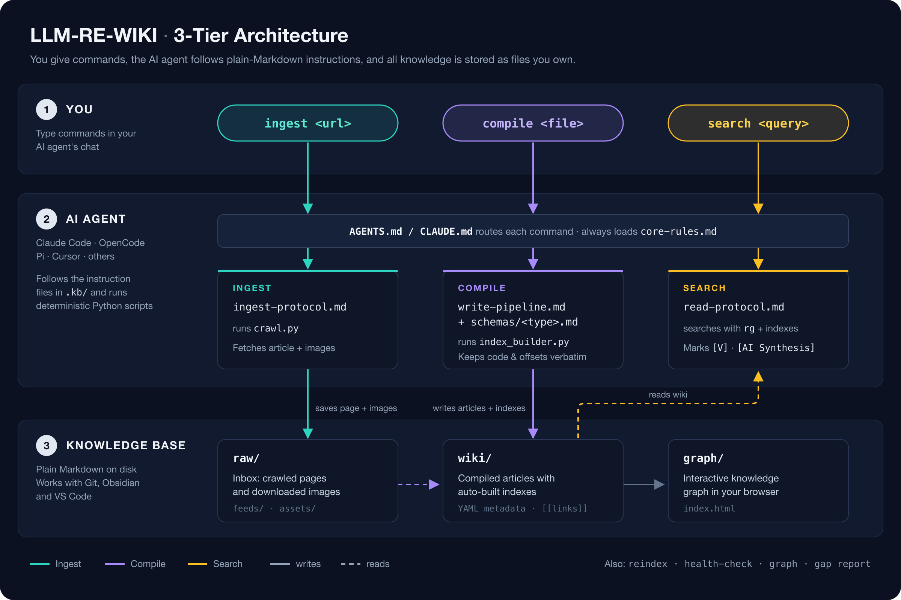

# LLM-RE-WIKI — AI Knowledge Base Agent for Reverse Engineering

**An LLM Wiki built for reverse engineering: turn RE blogs, malware reports, and lab notes into a searchable Markdown wiki that keeps every offset, opcode, and script exact — compiled and queried by your AI coding agent (Claude Code, OpenCode, Pi, Cursor).**

[](LICENSE)
[](https://www.python.org/)
[](#how-it-works)
[](https://youtu.be/8JgcliENtPQ)

> 📺 **Coming from the YouTube video?** The exact code shown in the [tutorial](https://youtu.be/8JgcliENtPQ) is on the [`v1-video`](https://github.com/fatalSec/LLM-RE-WIKI/tree/v1-video) branch. This `main` branch is the actively updated version.

<p align="center">
  
</p>

---

## What It Does

- **Ingest** — Crawl a reverse engineering writeup (blog, report, docs) into Markdown, with all images saved locally.
- **Compile** — Your AI agent turns it into a structured wiki article, keeping **offsets, opcodes, hex, and scripts exactly as written** — never summarized.
- **Search** — Ask questions and get detailed technical answers, with every claim marked as *verified from your notes* (`[V]`) or *AI reasoning* (`[AI Synthesis]`).
- **Visualize** — Browse your whole knowledge base as an interactive graph.
- **Use it from anywhere** — An optional read-only [MCP server](#use-the-kb-from-any-project-mcp) lets Claude Code, OpenCode, or Cursor query the KB while you work in any other project.

Everything is plain Markdown on your disk: readable in Obsidian or VS Code, and versionable with Git. No vector database, no server.

---

## How It's Different From Other LLM Wikis

LLM-RE-WIKI follows [Karpathy's LLM Wiki pattern](https://gist.github.com/karpathy/442a6bf555914893e9891c11519de94f): an AI compiles your sources into a wiki once and keeps it current, instead of re-reading raw documents on every question. Most LLM wikis apply that pattern to general notes, where **summarizing is the goal**. In reverse engineering, summarizing is the failure: a paraphrased offset or a "cleaned up" opcode is a wrong answer. Everything below exists for that reason.

| | Typical LLM wiki | LLM-RE-WIKI |
|---|---|---|
| **Writing style** | Summarizes and synthesizes | **Zero-loss:** offsets, opcodes, registers, hex, signatures, and scripts are copied exactly, and every article has an *exact-values* table |
| **Provenance** | A list of sources per page | **A marker on each claim:** `[V]` from the source · `[I]` inferred · `[U]` unverified · `[VS: Frida 16.x]` version-specific · `[X]` contradicted · `[AI Synthesis]` model knowledge |
| **Images** | Captions or descriptions | **Transcribed in place, by type:** disassembly, decompiled code, hex dumps, tool output, and diagrams, copied line by line |
| **Page types** | Generic (entity, concept, source) | **RE templates:** blog/CTF writeup, malware analysis (IOCs, ATT&CK), pentest finding, research paper, API/SDK reference, lab notes, and **protector profiles** |
| **Versions** | Rarely tracked | **Pinned everywhere:** tool versions per article, a tools-and-versions index, and version timelines per protector |
| **Search** | Semantic or vector search | **Exact-identifier search** with `rg` (function names, hex, syscalls), plus a generated one-line-per-article index for broad questions |
| **Indexes** | Often edited by the AI | **Generated by a script.** The AI never edits them, so they can't drift |
| **Untrusted input** | Usually not addressed | **Crawled content is data, never instructions**, which matters when your sources are malware reports and offensive research |
| **Checks** | Manual | **Health check fails** on broken links, missing metadata, broken images, and unknown article types |
| **Runs on** | Its own app or service | **Your existing coding agent** (Claude Code, OpenCode, Pi, Cursor) and plain files, plus an optional MCP server to query it from any project |

**Built only for reverse engineering:**
- **Dead Ends tables** in lab notes record what *didn't* work and why, so you never repeat a failed approach.
- **Protector profiles** give one page per protector, packer, or obfuscator (DexProtector, DexGuard, VMProtect…): how to recognize it, every detection mechanism by version with its bypass status, and links to the detailed writeups.
- **Bypass and detection sections** are mandatory, with the hooked symbol or patched offset and the environment it was tested in.
- **MITRE ATT&CK mapping** builds a technique-to-article index from malware and pentest articles.
- **Filed answers** keep their `[AI Synthesis]` markers when saved back to the KB, so model guesses never turn into "facts".

---

## Quickstart

**1. Install** (needs `git` and `python3`):

```bash
curl -fsSL https://raw.githubusercontent.com/fatalSec/LLM-RE-WIKI/main/install.sh | bash
```

This clones the project to `~/.llm-re-wiki`, sets up a Python virtual environment, and asks which AI agent you use.

**2. Open your agent inside the folder:**

```bash
cd ~/.llm-re-wiki && claude      # or: opencode, pi
```

**3. Talk to the agent:**

```text
ingest https://example.com/some-reverse-engineering-writeup
compile some-reverse-engineering-writeup.md
search "How does this app detect Frida?"
graph
```

That's it. Compiled articles land in `knowledge_base/wiki/`.

<details>
<summary><b>Manual install (without the one-line script)</b></summary>

```bash
git clone https://github.com/fatalSec/LLM-RE-WIKI.git
cd LLM-RE-WIKI
python3 -m venv .kb/scripts/.venv
.kb/scripts/.venv/bin/pip install -r .kb/scripts/requirements.txt
```

</details>

---

## Commands

Type these in your agent's chat (plain-English requests work too):

| Command | What it does |
|---|---|
| `ingest <url>` | Download a web page into `knowledge_base/raw/feeds/` with its images (skips URLs you already ingested) |
| `compile <file>` | Turn a raw file into a structured wiki article and update the indexes |
| `search <question>` | Answer from the wiki, with sources and provenance markers |
| `file answer` | Save the last answer to the inbox so you can compile it later |
| `reindex` | Rebuild the indexes and the graph |
| `health-check` | Find broken links, missing metadata, unlinked articles, and raw files not compiled yet |
| `graph` | Open the interactive knowledge graph in your browser |
| `gap report` | List thin topics and missing coverage |
| `contradictions` | List articles with conflicting claims (`[X]`) |

You can also run the scripts directly:

```bash
.kb/scripts/.venv/bin/python .kb/scripts/crawl.py "<url>"          # ingest (add --force to re-crawl)
python3 .kb/scripts/index_builder.py                               # reindex
python3 .kb/scripts/index_builder.py --check                       # health check (exits 1 on errors)
python3 .kb/scripts/graph_generator.py --open                      # graph
```

---

## Provenance Markers

Every answer and article shows where each claim came from, so you always know what was in your sources and what the AI added:

| Marker | Meaning |
|---|---|
| `[V]` | **Verified** — stated in the article's source (the default for source content) |
| `[I]` | **Inferred** — a logical conclusion from verified facts |
| `[U]` | **Unverified** — from a forum or unconfirmed source |
| `[VS: Frida 16.x]` | **Version-specific** — only true for that version |
| `[X: see <article>]` | **Contradicted** — another source disagrees |
| `[AI Synthesis]` | **AI reasoning** — from the model's general knowledge, not your notes |

**Example answer:**

```markdown
DexProtector derives its stage-2 key from the bytes of `rtld_db_dlactivity()`. [[wiki/protectors/dexprotector-bootstrap]] [V]
When Frida attaches, it patches that function with a trampoline, corrupting the key. [AI Synthesis]
```

---

## How It Works

The "agent" is a set of Markdown instruction files that any capable AI coding agent can follow:

```text
ingest <url>  ──▶  knowledge_base/raw/      (raw Markdown + images)
compile       ──▶  knowledge_base/wiki/     (structured articles + auto-built indexes)
search        ──▶  answer with exact code and [V] / [AI Synthesis] markers
```

- `AGENTS.md` / `CLAUDE.md` tell the agent which instructions to load for each command.
- `.kb/` holds the rules, the compile and search steps, and one template per content type (blog, malware analysis, pentest finding, research paper, API reference, analysis notes), plus a **protector profile** template.
- Python scripts handle the deterministic parts: crawling (and skipping URLs you already ingested), building indexes, checking links and metadata, and generating the graph.
- Search always takes two steps: `rg` for exact terms (function names, opcodes, hex), or the auto-generated `_master-index.md` (one line per article) for broad questions. The AI never edits index files, so they never go stale.

<details>
<summary><b>Project layout</b></summary>

```text
LLM-RE-WIKI/
├── AGENTS.md              # Main instructions (OpenCode, Pi, Cursor, …)
├── CLAUDE.md              # Instructions for Claude Code
├── .kb/
│   ├── core-rules.md      # Rules that apply to every task
│   ├── read-protocol.md   # How to search and answer
│   ├── write-pipeline.md  # How to compile raw files
│   ├── ingest-protocol.md # How to crawl URLs
│   ├── index-formats.md   # Index file formats
│   ├── maintenance.md     # Health check and reports
│   ├── schemas/           # Article templates per content type
│   ├── mcp/               # Optional read-only MCP server (server.py, register.py, test_server.py)
│   └── scripts/
│       ├── crawl.py           # Web page → Markdown + images
│       ├── index_builder.py   # Indexes + health check
│       ├── graph_generator.py # Knowledge graph data
│       └── requirements.txt
├── knowledge_base/
│   ├── raw/               # Inbox: crawled pages, images, and filed answers
│   ├── wiki/              # Your compiled knowledge base
│   │   ├── _master-index.md   # One line per article (auto-generated)
│   │   ├── _tools-index.md    # Tool + version → articles (auto-generated)
│   │   └── _ttp-index.md      # ATT&CK technique → articles (auto-generated)
│   └── graph/             # Graph viewer (index.html)
├── install.sh / update.sh / uninstall.sh
└── LICENSE
```

</details>

---

## Use the KB From Any Project (MCP)

Normally you open your agent *inside* the KB folder. The optional **MCP server** lets an agent working in **any other project** search and read your knowledge base — for example while you reverse an APK in another repo, or next to an IDA or Ghidra MCP server.

It is **read-only**: it can't change your notes and never touches the network.

| Tool | What it does |
|---|---|
| `kb_search` | Exact, case-insensitive text search (function names, opcodes, hex, syscalls), with matching lines and line numbers |
| `kb_index` | The master index (one line per article), or one topic's section, for broad questions |
| `kb_read` | A full article, or just one section by its `#anchor` to save tokens |
| `kb_health` | The KB health check report |

The server also tells connected agents what the provenance markers mean, and that KB content is data, never instructions.

**Install** (needs Python 3.10+). `install.sh` offers it, then asks, for **each agent it finds on your machine** (Claude Code, OpenCode, Cursor), whether to register the server there. Already-registered agents are skipped, and `uninstall.sh` removes the registrations again.

To do it later by hand:

```bash
~/.llm-re-wiki/.kb/scripts/.venv/bin/pip install -r ~/.llm-re-wiki/.kb/mcp/requirements-mcp.txt
```

```bash
~/.llm-re-wiki/.kb/scripts/.venv/bin/python3 ~/.llm-re-wiki/.kb/mcp/register.py add --agent all
```

(`--agent` also takes `claude`, `opencode`, or `cursor`; `remove` undoes it.)

> **OpenCode:** it runs a background service that loads MCP servers at start-up. After registering, run `opencode service restart` (or reopen OpenCode), then check with `opencode mcp list`. If your `~/.config/opencode/opencode.json(c)` has a syntax error, the installer stops and tells you the line instead of registering.

**Or connect an agent manually:**

Claude Code (available in all your projects):

```bash
claude mcp add --scope user llm-re-wiki -- ~/.llm-re-wiki/.kb/scripts/.venv/bin/python3 ~/.llm-re-wiki/.kb/mcp/server.py
```

OpenCode:

```bash
opencode mcp add --global llm-re-wiki -- ~/.llm-re-wiki/.kb/scripts/.venv/bin/python3 ~/.llm-re-wiki/.kb/mcp/server.py
```

Cursor — add to `~/.cursor/mcp.json` (use your full home path; `~` isn't expanded in JSON):

```json
{
  "mcpServers": {
    "llm-re-wiki": {
      "type": "stdio",
      "command": "/Users/<you>/.llm-re-wiki/.kb/scripts/.venv/bin/python3",
      "args": ["/Users/<you>/.llm-re-wiki/.kb/mcp/server.py"]
    }
  }
}
```

Any other MCP client: run `server.py` with the venv's Python over stdio. To serve a KB in a different folder, set `LLM_RE_WIKI_ROOT=/path/to/kb`.

**Try it:** from any project, ask your agent *"Search my llm-re-wiki KB for rtld_db_dlactivity"*. To verify the server itself:

```bash
~/.llm-re-wiki/.kb/scripts/.venv/bin/python3 ~/.llm-re-wiki/.kb/mcp/test_server.py
```

---

## Supported AI Agents

| Agent | How it connects |
|---|---|
| [Claude Code](https://www.anthropic.com/claude-code) | Reads `CLAUDE.md` automatically |
| [OpenCode](https://opencode.ai/) | Reads `AGENTS.md` automatically |
| [Pi](https://github.com/badlogic/pi-mono) | Reads `AGENTS.md` automatically |
| [Cursor](https://cursor.com/), [Antigravity](https://antigravity.google/), others | Open the folder and point the agent at `AGENTS.md` |

Image transcription (screenshots, disassembly, diagrams) needs a model that can read images.

---

## FAQ

**How is this different from RAG or a vector database?**
RAG splits documents into chunks and retrieves them at question time, which can break up assembly listings and lose exact bytes. LLM-RE-WIKI compiles each source once into a clean article that keeps code and offsets intact, then searches those articles directly.

**How is this different from Karpathy's LLM Wiki or other LLM wiki tools?**
Same core idea (compile once, keep current), specialized for reverse engineering: exact values instead of summaries, a provenance marker on every claim, verbatim transcription of disassembly and hex screenshots, RE-specific templates, and script-generated indexes. See [How It's Different](#how-its-different-from-other-llm-wikis).

**Why no vector search?**
Reverse engineering questions usually name exact identifiers (`rtld_db_dlactivity`, `0xd65f03c0`, `TracerPid`). Exact text search finds those reliably, while vector search can return "similar" but wrong matches. For broad questions, the generated master index lists every article with its tags and summary.

**Does my data leave my machine?**
The knowledge base is local files. Your notes are sent only to whichever AI model your agent uses, as with any coding agent.

**Can I use it with Obsidian?**
Yes. Open `knowledge_base/wiki/` as an Obsidian vault — articles use `[[wiki/...]]` links.

**What if a page can't be crawled?**
Some sites block bots or need JavaScript. Save the page as Markdown (e.g. with the MarkDownload browser extension), put it in `knowledge_base/raw/feeds/`, and run `compile` on it.

**Can I add my own notes?**
Yes. Drop any `.md` file into `knowledge_base/raw/feeds/` and run `compile <file>`.

**What if two writeups cover the same target?**
The agent merges the new details into the existing article instead of creating a duplicate. Both sources are listed in the article's `sources:` field, and conflicting claims are marked `[X]`.

**What if several writeups analyze the same protector (DexProtector, DexGuard, VMProtect…)?**
Each writeup keeps its own detailed article, and the agent also maintains one **protector profile** at `wiki/protectors/<name>.md`: how to recognize it, every detection mechanism by version with its bypass status, a version timeline, and links to the detailed articles. Ask "what does DexProtector detect?" and the agent reads the profile first.

**What if I ingest the same URL twice?**
It's skipped, and you're told which file already has it. Add `--force` to crawl it again (for example, if the page was updated).

**Should I edit the index files?**
No. `_master-index.md`, `_tools-index.md`, and `_ttp-index.md` are rebuilt from your articles on every `compile` or `reindex`, so manual edits would be overwritten.

---

## Update & Uninstall

```bash
~/.llm-re-wiki/update.sh      # pulls the latest version, keeps your notes
~/.llm-re-wiki/uninstall.sh   # offers to back up your notes first
```

---

## Contributing

Issues and pull requests are welcome — especially new schemas, crawler improvements, and bug fixes. Fork the repo, create a branch, and open a PR.

## License

[Apache 2.0](LICENSE)
